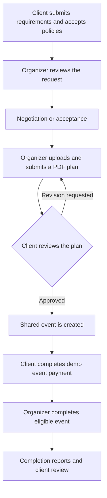

# EventFlow

## Event Registration, Planning & Attendee Management Platform

EventFlow connects clients, event organizers, attendees, event staff, support executives, finance executives, and administrators through a shared event management system.

## 1. Overview

EventFlow is a web application that supports the event lifecycle: discovering events, submitting event requirements, negotiating plans, approving proposals, registering attendees, recording payments, coordinating staff, verifying attendance, and reviewing reports.

The application uses a React frontend and a NestJS REST API. Role-specific workspaces display backend data, while a local JSON data store preserves records between server restarts. Seeded accounts and sample records support development and project demonstrations.

This README describes the current implementation. Development limitations and possible extensions are listed separately at the end.

## 2. Problem Definition

Managing an event often involves separate conversations, spreadsheets, registration lists, payment records, and attendance sheets. This can cause inconsistent event information, missed requests, overbooking, delayed responses, and difficulty tracking responsibilities.

EventFlow provides a shared system in which each participant can perform their assigned tasks and see relevant updates. Clients and organizers share a planning workflow; attendees manage their registrations; operational users handle assignments, customer requests, and reports; administrators monitor the platform.

## 3. System Actors

| Actor | Main responsibility |
| --- | --- |
| Attendee | Discover events, register, manage tickets, and follow event updates. |
| Client | Request an event, review plans, approve the agreed scope, and complete event payments. |
| Event Organizer | Plan and manage events, coordinate staff, review registrations, and submit event reports. |
| Event Staff | Respond to assignments, maintain availability, verify attendance, and submit attendance reports. |
| Support Executive | Manage customer account details, review registrations, handle customer requests, and report operational findings. |
| Finance Executive | Monitor payments, revenue, refund records, and financial reporting. |
| Super Admin | Oversee platform activity, manage accounts, and review executive reports. |

Support and finance executives use department-specific employee types under the backend's `event_staff` role. They have different permissions and interfaces from ordinary event staff.

## 4. Features by Actor

### 4.1 Attendee

- Browse the public event catalog and search by event name, location, or category.
- View event details, prices, capacity, and registration requirements.
- Create an attendee account and sign in to a personal workspace.
- Register for free or paid events, subject to capacity and registration deadlines.
- Complete simulated checkout and access ticket and QR verification information.
- Join a waitlist when the event configuration permits it.
- View registration status, organizer decisions, and decline reasons.
- Cancel eligible registrations and track associated refund information.
- Receive in-app notifications and submit customer support requests with attachments and follow-up messages.

### 4.2 Client

- Discover organizers and view organizer profiles, ratings, and reviews.
- Submit event requirements, including the date, venue, budget, capacity, and required services.
- Read and acknowledge the event rules, cancellation policy, and terms.
- Track requests and respond to proposed changes or counteroffers.
- View uploaded PDF plans, approve a final plan, or request a revision with a reason.
- Complete the agreed event payment through the demo payment workflow.
- Cancel an eligible approved event after reviewing the applicable fee and refund amount.
- View completion information, download organizer report files, and submit organizer reviews.

### 4.3 Event Organizer

- Review incoming client requests and accept them for planning or respond with changes or a rejection reason.
- Upload event plan PDFs and submit or revise linked plans.
- Create and maintain event details, schedules, venue information, capacity, and ticket prices.
- Review registrations and approve or decline them with an attendee-visible reason.
- Discover staff, inspect availability, and send assignments with a role, fee, and notes.
- Track assignment responses and attendance information.
- Complete eligible events after the required payment and date checks.
- Submit completion reports, supporting photos, and event report documents to the requesting client.

### 4.4 Event Staff

- View assigned events and accept or decline assignments.
- Maintain available dates and view booked dates.
- Access registration information for assigned events.
- Verify attendees using a scanned QR code or a manually entered verification ID.
- View attendance information and submit attendance summaries to the organizer.
- Receive assignment notifications and maintain personal account details.

The event-staff workspace is available at `/staff`.

### 4.5 Support Executive

- View a dashboard of users, events, registrations awaiting review, customer requests, and operational issues.
- Search customer accounts and update permitted customer details or account status.
- Review attendee registrations and approve or decline them with a reason.
- Update event operational details and publication status within backend validation rules.
- Handle account, payment, registration, ticket, event, privacy, and technical concerns through the Customer Requests queue.
- Reply to requesters, update request status, and retain conversation history.
- Save report drafts or submit reports in three categories: Registration & User Management, Event Operations Report, and Support & Issue Summary.
- Attach PDF, Word, or Excel report documents up to 10 MB and view admin review feedback.

Staff directories and other staff-management data are excluded from this workspace. Support executives cannot change other employee or administrator accounts or assign privileged account roles.

### 4.6 Finance Executive

- View recorded payment transactions and refund records.
- Review total revenue and event-level financial summaries.
- View calculated platform commission and organizer payout figures.
- Save or submit Support Reports, Finance Reports, and Combined Operational Reports.
- Track report status and receive notifications when an administrator reviews a submission.

The interface calculates commission at 15%. Payments, refunds, and payout figures are part of the demonstration workflow; they do not transfer money.

### 4.7 Super Admin

- View platform totals for users, events, registrations, payments, and request activity.
- Analyze user roles, account activity, joining trends, event categories, capacity, and revenue.
- Manage accounts through authorized account-management operations.
- Open a dedicated Reports page containing submitted support and finance executive reports.
- Search reports, filter by review status, view findings, and download available attachments.
- Mark reports as reviewed and provide feedback to the submitting executive.

The admin inbox includes six labeled sample reports for demonstration. Report drafts remain private to their authors.

## 5. Main Workflows

### Client event planning



Accepting a request starts planning. The shared event is created only after the client approves the final plan.

### Registration and attendance

1. The attendee selects an event and submits a registration.
2. The backend checks account eligibility, deadlines, capacity, and existing registrations.
3. A paid registration requires demo payment; a free registration can receive its ticket directly.
4. The organizer or an authorized support executive reviews the registration where applicable.
5. Assigned staff or authorized organizers verify attendance using the ticket's verification information.
6. Registration, attendance, payment, and notification records remain available to their permitted roles.

### Customer requests and executive reports

1. A client, organizer, or attendee submits a customer support request.
2. A support executive responds and updates its status. Requester follow-ups can reopen the conversation.
3. Support or finance executives prepare reports and submit them to the administrator.
4. The administrator reviews the submitted report and records feedback.
5. The author sees the updated report status and receives a notification.

### Client event cancellation policy

For approved client events, the current policy requires at least 14 days' notice before the scheduled start time in India Standard Time. Cancellation requires a reason and confirmation of the displayed financial calculation. The fee is 10% of the amount actually paid, with the remaining 90% recorded as a pending refund. An unpaid event has no cancellation fee.

This policy applies to the client event workflow; attendee ticket cancellation follows the registration and event rules.

## 6. Supporting Services and Integrations

| Service or capability | Current use |
| --- | --- |
| REST API | Shares authorized data and saved changes between role workspaces. |
| JWT authentication | Authenticates protected requests using bearer tokens. |
| Browser camera and QR decoding | Supports camera-based attendee verification, with manual entry available. |
| SMTP through Nodemailer | Sends support-resolution emails when configured. |
| In-app notifications | Delivers request, registration, assignment, payment, and report updates. |
| File uploads and downloads | Stores and retrieves supported plans, reports, photos, and support attachments. |
| Demo payment provider | Simulates payment and refund records without transferring real money. |

Organizer reviews and ratings are maintained within EventFlow. No external ratings service, GPS service, or SMS provider is required to run the project.

## 7. Technology Stack

| Layer | Technologies |
| --- | --- |
| Frontend | React 19, React Router 7, Vite 7, JavaScript, HTML, CSS |
| Backend | NestJS 10, TypeScript, Node.js, REST APIs |
| Authentication and validation | Passport JWT, class-validator, class-transformer |
| Files, tickets, and messaging | Multer, QR code generation/decoding, Nodemailer |
| Runtime storage | In-memory collections backed by a local JSON file; uploaded files stored on disk |
| Testing | Node.js test runner, API integration tests, and frontend runtime/rendering tests |

The frontend combines React components with preserved DOM-driven role runtimes loaded through `LegacyRuntime`. The migration of those dynamic screens to React state is ongoing.

## 8. Project structure

```text
Penguin_10_React/
├── README.md
├── Database/                    # Schema and ER diagram
├── backend/                     # NestJS API
└── React_frontend/
    ├── index.html               # Vite page entry
    ├── package.json             # Dependencies and scripts
    ├── vite.config.js           # Build output in build/
    ├── public/assets/           # Images, vendor scripts, demo reports
    ├── tests/                   # Frontend tests
    └── src/
        ├── main.jsx             # React bootstrap
        ├── app/                 # App shell and URL routes
        ├── styles/global.css    # Shared stylesheet
        ├── shared/              # APIs, components, utilities used by all roles
        └── apps/                # One folder for each role interface
```

Each role under `src/apps/` has `api/`, `app/`, `assets/`, `components/`, `context/`, `data/`, `hooks/`, `pages/`, `styles/`, `utils/`, and a README. The role page preserves the existing DOM-driven runtime; the app component is its route entry. Shared scripts stay in `src/shared/` because each role loads them through `LegacyRuntime`.

The [SQL schema](Database/Dbschema.sql) and [ER diagram](<Database/ER Diagram.png>) document the database design. The current backend runs with JSON persistence and does not require importing the SQL schema.

## 9. Installation and Local Setup

### Prerequisites

- Node.js matching Vite's supported range: `^20.19.0` or `>=22.12.0`.
- npm.
- A browser; camera access is needed only for camera-based QR scanning.

Run the following commands from the project root in two separate terminals. There is no root-level npm application.

### Terminal 1: Backend

```sh
cd backend
npm ci
npm run start:dev
```

### Terminal 2: Frontend

```sh
cd React_frontend
npm ci
npm run dev
```

| Local service | Address |
| --- | --- |
| Frontend | `http://localhost:5173` by default; use the URL printed by Vite. |
| Backend API | `http://localhost:3001/api` |
| Swagger UI | `http://localhost:3001/docs` |
| Generated API specification | `backend/docs/swagger.json` |

### Optional backend configuration

Create `backend/.env` when custom configuration is needed. SMTP settings are illustrated in [backend/.env.example](backend/.env.example).

```dotenv
PORT=3001
JWT_SECRET=replace-with-a-local-secret
# EVENTFLOW_DATA_FILE=C:/path/to/eventflow-store.json

# Configure these to enable support-resolution emails.
# SMTP_HOST=your-smtp-host
# SMTP_PORT=587
# SMTP_SECURE=false
# SMTP_USER=your-smtp-user
# SMTP_PASSWORD=your-smtp-password
# SMTP_FROM=EventFlow Support <support@example.com>
```

The application can run without SMTP. Replies and ticket status changes are still saved when email delivery is unavailable.

Frontend API URLs currently target `http://localhost:3001/api`. Changing only `PORT` does not update the frontend; update the corresponding URLs in React_frontend services, components, and role runtimes if the backend address changes.

## 10. Demo Accounts and Workspaces

These credentials are part of the development seed data.

| Actor | Email | Password | Workspace |
| --- | --- | --- | --- |
| Super Admin | `superadmin@example.com` | `Admin@123` | `/admin` |
| Client | `client@example.com` | `Client@123` | `/client` |
| Event Organizer | `organizer@example.com` | `Organizer@123` | `/organizer` |
| Attendee | `attendee@example.com` | `Attendee@123` | `/attendee` |
| Support Executive | `employee@example.com` | `Employee@123` | `/employee1` |
| Finance Executive | `marcus.ops@eventflow.com` | `Employee@123` | `/employee2` |
| Event Staff | `staff@example.com` | `Staff@123` | Backend and staff workspace source; see Section 14. |

Start at `/` or `/landing` to sign in. `/employee` aliases the support workspace. `/employee2` serves the Finance Executive workspace, and `/staff` serves the event-staff workspace.

New attendee accounts become active after registration. New client, organizer, and ordinary staff accounts are saved with pending status and require activation before sign-in. Public registration cannot create administrator or department-executive accounts. Account email uniqueness is enforced across roles.

## 11. Data Communication and Persistence

- `GET /api/workspace` supplies an authenticated snapshot filtered for the user's role.
- Shared frontend synchronization loads backend records before rendering authenticated pages.
- Idle, visible workspaces check for updates every 8 seconds; the public event catalog refreshes every 15 seconds. Focus and cross-tab change signals also trigger refreshes.
- Open forms and dialogs defer background page replacement to preserve user input.
- Failed saves display an error and retain input rather than reporting a successful local-only change.
- The backend saves records to `backend/data/eventflow-store.json` by default. `EVENTFLOW_DATA_FILE` can select another location.
- Uploaded files are stored separately under `backend/uploads`; keep them with the data file when preserving a development environment.
- Browser session storage holds the current session. Legacy local storage also retains UI and compatibility data, while the shared synchronized views use backend records.

The JSON data file contains development account information, including demo passwords. It is intended for local development rather than production database use.

## 12. API Areas

All paths below are relative to `http://localhost:3001`. Protected endpoints require `Authorization: Bearer <token>`; the backend obtains identity and permissions from the authenticated account.

| API area | Main endpoints or purpose |
| --- | --- |
| Authentication | `POST /api/auth/login`, `POST /api/auth/register`, `POST /api/auth/password` |
| Shared workspace | `GET /api/workspace`; authorized customer and event operations under `/api/workspace` |
| Public discovery | `GET /api/public/events` |
| Accounts and profiles | `/api/users`, `/api/attendees`, `/api/staff` |
| Events | `/api/events` |
| Client planning | `/api/event-requests`, `/api/event-plans` |
| Registrations | `/api/registrations`, including reviews and cancellation |
| Payments | `/api/payments`, client event payments, and simulated refund processing |
| Staff coordination | `/api/staff-assignments` |
| Attendance | `/api/attendance`, including verification and reconciliation |
| Reporting | `/api/reports/events`, `/api/reports/staff`, `/api/reports/support`, `/api/reports/operational` |
| Customer support | `/api/support` |
| Notifications and analytics | `/api/notifications`, `/api/analytics` |

Use the Swagger UI for individual methods, request schemas, and response details. Service-level authorization and ownership checks apply to each operation.

## 13. Testing and Builds

### Frontend

```sh
cd React_frontend
npm test
npm run build
```

### Backend

```sh
cd backend
npm test
npm run build
```

Automated coverage includes authentication and account restrictions, cross-role data communication, event planning and approval, payments and cancellation, registration reviews and decline reasons, customer support conversations, executive report submission and feedback, staff assignments, QR scanning, persistence, and rendering updates. API integration tests use temporary data stores.

After a backend build, `npm run start:prod` starts the compiled backend. After a frontend build, `npm run preview` serves a local preview of the frontend output; the backend must still be running.

## 14. Current Implementation Notes

- **Staff route:** `/staff` now serves the event-staff workspace.
- **React migration:** Several workspaces still use preserved JavaScript runtimes through `LegacyRuntime`; the interface is not entirely managed by React state.
- **Demo payments:** Checkout, refunds, and financial records are simulated. There is no live payment gateway or bank payout integration.
- **Demo verification:** The registration interface displays a demo OTP. It is not an email-delivered verification service.
- **Local storage design:** Runtime persistence uses a local JSON file and disk uploads. The relational schema is a design artifact, not the active storage engine.
- **Deployment work:** Production database integration, password hashing, deployment-specific API configuration, and replacement of demo authentication/payment behavior remain separate implementation tasks.

Possible extensions include completing the React migration, using a transactional database, adding server-pushed updates, and integrating real payment and email-verification providers.
